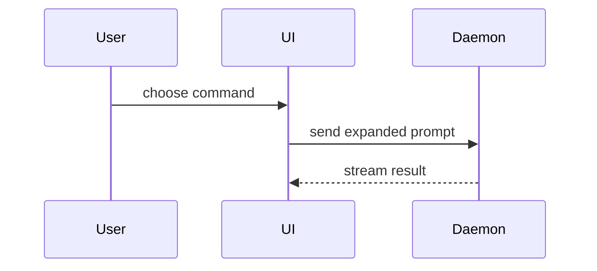

# Implementation Writer

Write a reviewer-oriented implementation report for the completed task.

Use the originating plan supplied by the workflow when present. When the workflow supplies a standalone task without a plan, use that task as the implementation intent; a plan is not required.

Inspect the final repository diff, the plan if supplied, the task file, the contract file if supplied, and the implementation and validation summary from the workflow. Write the implementation report at the path named by the workflow. Write no other file except the empty `small-change.txt` beside that report when the qualification below is established.

When a contract is supplied, link it in the summary and don't re-describe it: the implementation report covers how the task implements it.

Use the implementation and validation summary, changed files, accumulated deferred and unresolved findings, risks, full review-round count, any post-style result, and loop exit reason supplied by the workflow. Include only evidence visible in the final code, diff, plan, contract, or validation results.

Also use the workflow's final task-change scope, measured additions and deletions with their measurement evidence, and provisional success eligibility with validation and completion evidence. Missing evidence cannot establish qualification. Success requires an exit of `No new actionable findings`, `No new edits`, or `Post-style passed`, all required validation passing, no remaining "fix now" findings or open user decisions, no incomplete task requirements, and a successfully written report. Commit success is not required.

Return only the written path and any unresolved risk that prevented a complete implementation report.

Use this template for writing the implementation report:

```markdown
# Implementation

## Summary

<diagram, diff-sketch, or tree>

## Evidence

- **Before:** <screenshot/output/failing test run>
  **After:** <screenshot/output/passing test run>

## Merge Danger

**Door:** <one-way or two-way>

<evidence and rollback cost>

**Blast Radius:** <one-word description>

<evidence of scope, shared-contract effects, and consumer coordination>

**Size:** <additions> + <deletions> = <total> lines; limit 1,000; <pass, fail, or unknown, with measurement evidence>

**Review cycles:** <full review-round count>; limit 3; <pass, fail, or unknown, with evidence; exclude style passes and validation retries>

**Implementation success:** <yes, no, or unknown, with validation, completion, exit, and report-write evidence>

**Small change:** <yes or no> — <combined result and justification; identify failed or unproven criteria>

## Deferred work

- <Work deliberately left out> — <location evidence and justification for leaving it out>

## Completion

- Changed files: <complete list of task-owned changed files>
- Full review rounds: <number>
- Post-style: <pass, fail, or incomplete, with evidence; omit if not run>
- Exit reason: <loop exit reason supplied by the workflow>
```

## Sections

Skip all preambles and keep prose brief. Use the user's domain language from `GLOSSARY.md`.

### Summary

Pick the smallest view that makes the key point clear.

- Show logic or an algorithm as pseudocode:

```text
on(save)
  if content is unchanged
    return cached result
  write new content
  return fresh result
```

- Show runtime control flow as a call tree:

```text
submitForm
  createSession
    persistPrompt
    launchAgent
  navigateToSession
```

- Show UI structure as a component tree, including state and module boundaries that matter:

```text
<SessionPage> (apps/example/src/routes/session.tsx)
  useSessionEvents()
  <SessionToolbar>
    <RunSkillButton> (packages/ui)
```

- Show file responsibility or a broad refactor as a shallow file tree:

```text
src/
├── commands/       # parses user actions
├── sessions/       # owns session state
└── transport/      # sends API requests
```

- Show component interaction, control flow, or data flow with Mermaid:



- Use `diff` when the point is what changes and the surrounding shape already exists. Match the diff shape to the topic.

For a component change:

```diff
 <SessionPage>
   useSessionEvents()
   <SessionToolbar>
+    <RunSkillButton />
   <SessionTimeline>
+    <SkillResultCard />
```

For a file-layout change:

```diff
 src/
 ├── commands/
+│   └── show-me.ts       # expands the slash command
 ├── sessions/
-└── transport.ts
+└── transport/
+    ├── client.ts
+    └── stream.ts
```

For a call-tree or call-stack change:

```diff
 submitForm
   createSession
     persistPrompt
+    expandSkillMention
     launchAgent
-  navigateToSession
+  navigateToSession
+    subscribeToEvents
```

For a state or control-flow change:

```diff
 on(save)
-  write content
+  if content is unchanged
+    return cached result
+  write new content
+  invalidate cache
```

- Show the whole block when most of it is new, when omitted context would hide ownership or order, or when the user needs a copyable target shape:

```ts
function expandSkill(command: string): string {
  const skillName = command.slice(1);
  return `use the ${skillName} skill`;
}
```

#### Guidance

Place each visual next to the short text it supports. Keep only the calls, files, props, states, and boundaries needed to answer the user's current question or the options to resolve the current discussion point.

You may use one of these, you may use several, it is unlikely you will use all of them. Use your judgement and don't overwhelm the user.

### Evidence

Concrete evidence that the change works. Show a before and after.

Screenshots are S-tier - when the environment is set up for it and the change is visual.

Execution-based evidence is A-tier. Test results, console output. Show the exact test that now fails and passes, using pseudocode.

In Evidence, preserve every reported validation command and result. If before evidence was not captured, state that limitation rather than inventing it.

### Merge Danger

Describe whether it's a one-way or two-way door. You can walk back through two-way doors, but not one-way doors. A PR that is cheap to roll back is lower risk. Changes that involve destructive actions or hard-to-reverse decisions are one-way doors.

The blast radius is the potential impact or scope of the changes introduced by this PR. Consider all possibilities. Examples are layout shift, breakages for consumers, mobile responsiveness, etc.

Assess small-change qualification in every report, including unsuccessful and nonqualifying implementations. All of these conditions must be established:

- Implementation succeeded under the workflow's success conditions above, including successfully writing this report.
- The door is two-way under the existing rollback guidance above.
- Effects remain within one bounded behavior or component, with no shared-contract changes or required consumer coordination. Justify this judgment with evidence; a low line count alone cannot establish bounded impact.
- The final task diff totals at most 1,000 additions plus deletions, including new files. Count the final net diff rather than intermediate edits or review fixes. Multiple files do not independently disqualify a change.
- At most three full review rounds occurred under the workflow's existing count. The separate style pass and validation retries add no rounds. The round count is the sole review-related criterion; previously raised findings do not independently disqualify a change.

Expose each criterion, its evidence, and the combined result in Merge Danger. Treat missing evidence as unproven and classify the change as not qualifying. Do not add reviewer severity labels or critical-finding history.

Write and verify `implementation.md` successfully before creating a zero-byte `small-change.txt` beside it, and create that marker only if all criteria qualify. If the report write fails, do not create the marker or claim success. For a nonqualifying result, leave no marker. The marker is a downstream artifact, not a source-code change.

### Deferred work

In Deferred work, retain the workflow's accumulated incomplete work and deferred or unresolved findings, with their location evidence and reasons. Remove an item only when later implementation or validation evidence shows it was resolved. Justify omissions using the plan, contract, approved scope decisions, or implementation and validation evidence. Write `None.` when there is nothing to report.
